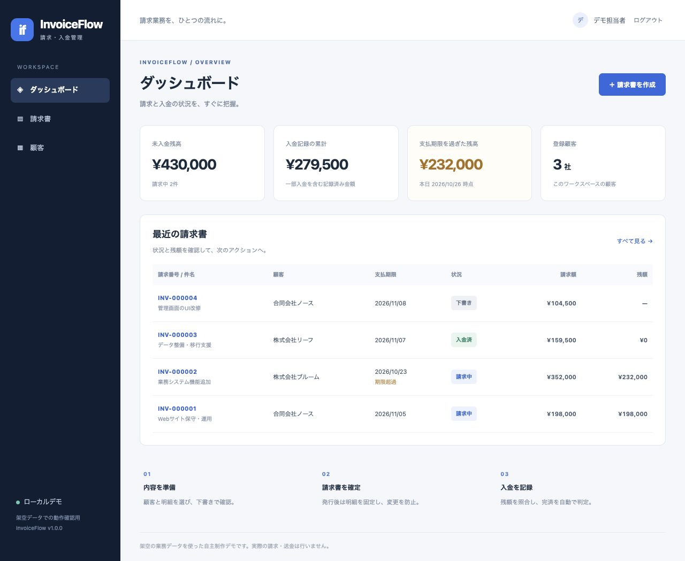
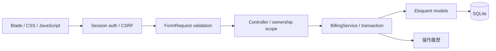

# InvoiceFlow — Laravel 請求・入金管理ポートフォリオ

**顧客 → 請求書の下書き → 発行 → 一部入金 → 完済**を、日本語の業務画面で操作できるPHP/Laravel作品です。

Laravel 13 / PHP 8.4 / Blade / Eloquent / SQLite / PHPUnit / Docker



## 解決したい業務課題

| 課題 | 実装 |
|---|---|
| 請求・未入金・期限超過が別管理 | ダッシュボードと請求一覧で状況/残額を可視化 |
| 発行後の金額が変更されてしまう | 下書きだけ編集可。発行後は明細を固定 |
| 他担当のデータが見えてしまう | 利用者の所有スコープを画面/更新/業務サービスで確認 |
| 入金操作の再送で二重計上 | 請求書＋送信UUIDで冪等性を保証。異なる内容のトークン再利用は拒否 |
| 同時入金で残高がマイナスになる | SQLite IMMEDIATE取引と条件付き更新で過入金を防止 |
| 金額の小数誤差・丸めが不明確 | 整数円で保存/計算。デモ税額は伝票小計から円未満切捨て |
| 画面の古い編集が後から上書き | versionによる下書きの楽観的排他制御 |

## 最短起動：Docker

Docker/Composeが利用できる環境で、リポジトリのルートから実行します。初回はイメージとComposer依存を取得するためインターネット接続が必要です。

```sh
docker compose up --build
```

ブラウザーで `http://127.0.0.1:8000` を開きます。

| デモアカウント | 値 |
|---|---|
| メール | `demo@invoiceflow.test` |
| パスワード | `DemoReview!2026` |
| 別担当者（空のデータ領域） | `other@invoiceflow.test` / 同じデモパスワード |

これらは公開可能な架空のローカルデモ資格情報です。外部公開サーバーで利用しないでください。

- マイグレーションと初回の架空データ投入を自動実行。
- アプリは非root。ホストの127.0.0.1へ接続先を限定。
- DB/セッション/デモ鍵は名前付きvolumeへ保存。再起動してもデータと鍵を保持。
- デモユーザーがある場合、再起動で請求や入金を増やしません。
- 終了はCtrl+C、バックグラウンド起動なら `docker compose down`。通常のdownはvolumeを削除しません。

## PHP/Composerで起動

PHP 8.4以上、Composer 2、PDO SQLite/mbstring等のLaravel依存拡張が必要です。Node/npmのインストールやフロントエンドビルドは不要です。

```sh
composer install
composer setup
php artisan serve --host=127.0.0.1 --port=8000
```

setupはlocal/testing環境専用。既存APP_KEYやデータを維持し、`.env`・DB・マイグレーション・架空データを準備します。依存の実バージョンはcomposer.lockに固定しています。

## 3分デモ

1. デモアカウントでログイン。初期状態は顧客3社・請求4件。
2. ダッシュボードで未入金430,000円、記録済み入金279,500円、期限超過232,000円を確認。
3. `INV-000002`を開き、232,000円を入金記録。残額0・入金済へ遷移する。
4. 顧客を追加し、明細付きの下書きを作成。内容を確認して発行する。
5. `other@invoiceflow.test`でログインし、別担当者のデータが表示されないことを確認する。

データの日付はSeeder実行日から相対的に作成します。表示画像は2026-10-26に撮影した実画面です。[詳しいデモ](docs/DEMO.md)

## 実装の構成



- Laravelのセッション認証、ログイン試行制限、CSRF保護、Bladeのエスケープ。
- FormRequestで顧客の所有・日付・数量・整数金額・明細数を検証。
- Controllerは画面/入力、BillingServiceは業務条件とDB取引を担当。
- 請求書/明細/入金/操作履歴を関連付け、成功した入金だけ履歴へ記録。
- ネットワーク送金・決済API・メール送信は行いません。

## 検証

```sh
composer test
vendor/bin/pint --test app bootstrap/app.php bootstrap/providers.php config database routes scripts tests
composer validate --strict
composer audit --locked
```

Dockerだけで試験する場合:

```sh
docker compose --profile test run --build --rm tests
```

実施結果は [検証報告](docs/VALIDATION.md) に記載。PHPUnitは**30テスト・192アサーション**が成功し、2つの独立したPHPプロセスによる過入金/同一トークンの競合試験を含みます。Pint・Composer定義検査・依存監査を実施しています。GitHub Actions定義は同梱していますが、リモートでの成功は公開後に確認してください。

## ドキュメント

- [設計・状態遷移・データ契約](docs/DESIGN.md)
- [画面/デモ手順](docs/DEMO.md)
- [テストと検証範囲](docs/VALIDATION.md)
- [設計/実装の自己レビュー](docs/REVIEW.md)
- [案件応募用の作品説明](docs/PORTFOLIO.md)
- [既知の制約](docs/LIMITATIONS.md)
- [GitHub公開手順](docs/GITHUB_PUBLISH.md)

## 利用範囲・制作方法

架空データを使うlocalhost専用の自主制作ポートフォリオです。請求書画面・税率はデモ仕様であり、適格請求書や税務要件への適合、本番運用、実際の送金を提供するものではありません。登録/パスワード再発行、管理者RBAC、バックアップ復旧、厳密な監査保全は未実装です。

検証・自己レビューにCodexを使用しました。Claude Codeによる反証レビューは未実施です。受託納品実績や独立した第三者監査と同一視していません。作品固有のライセンスは未設定（Composer表記はproprietary）。Laravel等の依存はそれぞれのライセンスに従います。
