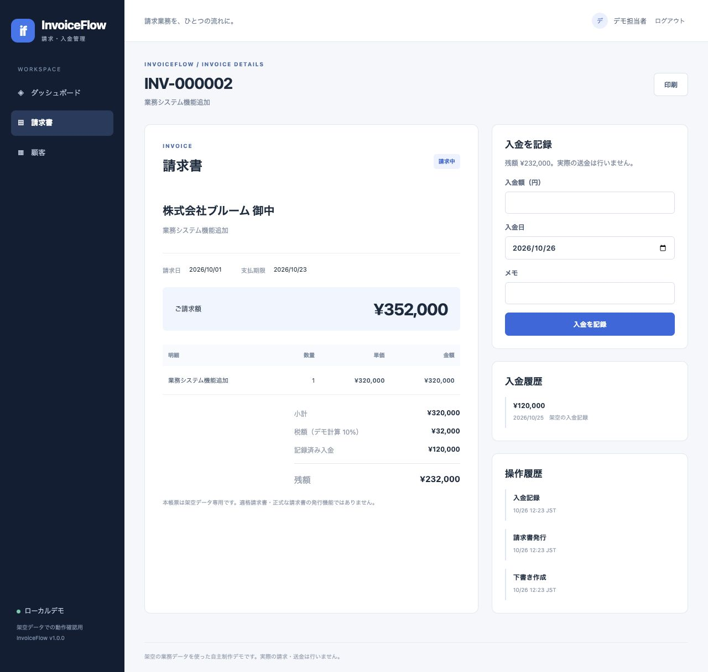
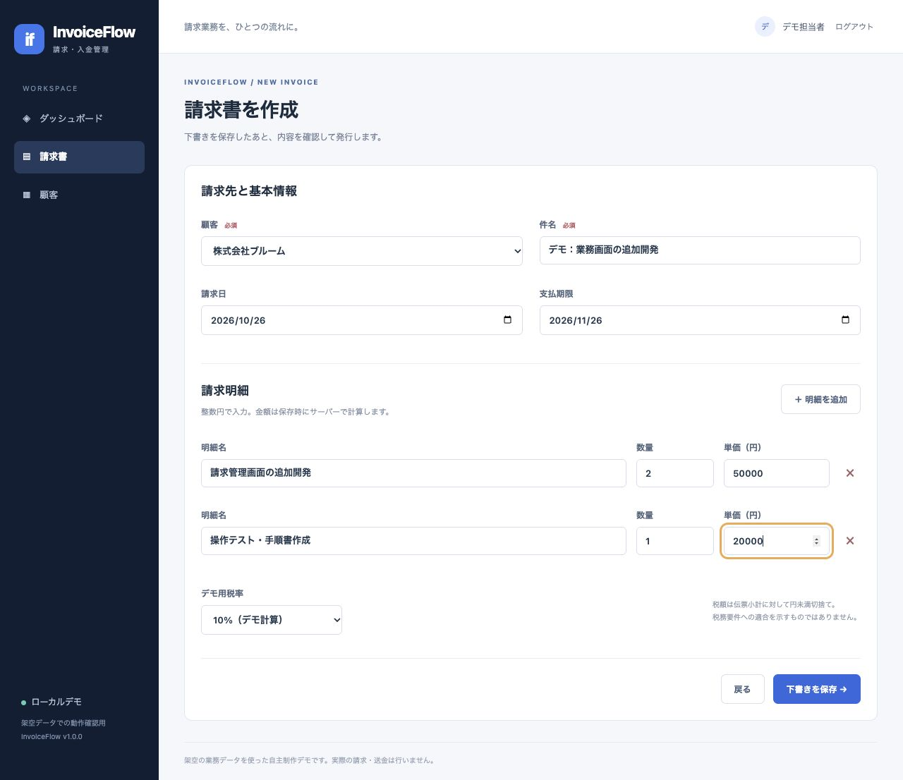

# デモ/画面確認手順

## 初期データ

local/testingのDemoSeederで以下を作る。デモユーザーが既存なら繰り返し投入しない。

- 顧客3社、請求4件（下書き1、請求中2、入金済1）。
- 未入金残高430,000円、累計入金279,500円、期限超過232,000円。
- 日付は投入日基準。画像は2026-10-26の初期状態。

## 一覧と詳細

1. demo@invoiceflow.test / DemoReview!2026でログイン。
2. ダッシュボードで初期集計を確認。
3. INV-000002を開く。小計320,000、税32,000、請求352,000、既入金120,000、残額232,000。
4. 入金額232000、当日、任意の架空メモを登録。
5. 入金済・残額0・履歴追加になる。実際の送金は行われない。



## 作成・発行

1. 顧客画面で架空の顧客を追加。
2. 請求書を作成し、顧客/件名/日付を入力。
3. 明細「開発」数量2・単価50000、追加明細「テスト」数量1・単価20000。
4. デモ税率10%で下書き保存。小計120,000、税12,000、請求132,000。
5. 下書きは編集可。発行ボタンで確定した後は明細を変更できない。
6. 一部入金、残額入金を記録。完済時は入金済になる。



## 検証したい異常系

- 残額を超える入金: サーバーでも拒否し、履歴/残高に変更なし。
- 同一送信UUIDで再送: 同じ記録を返し、増額しない（自動試験で確認）。
- 古い下書きのversionで編集: 変更済みメッセージ、最新内容を維持。
- other@invoiceflow.testへ切替: demo利用者の顧客/請求を表示せず、直接URLも拒否。
- ログアウト後の保護画面: ログインへ戻る。

## リセット

通常の再起動はデータを保持。Dockerのvolume削除は全デモデータを失うため、保存したい場合は実行しない。新しいComposeプロジェクト名で別volumeを作れば、既存を消さずに初期データを試せる。

```sh
docker compose -p invoiceflow-fresh up --build
```

既存アプリが8000番を使用していない状態で実行する。サービスを停止する場合は同じプロジェクト名を指定する。
