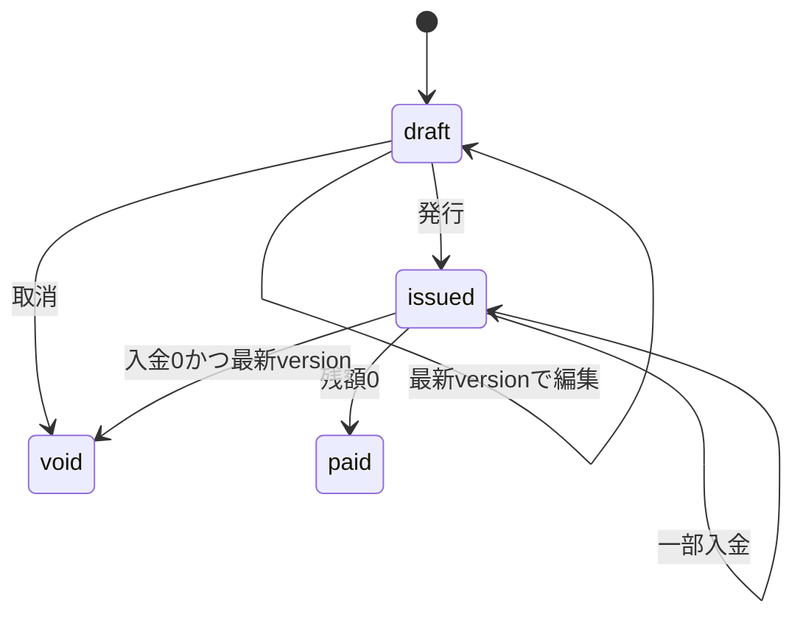

# 設計書 — InvoiceFlow 1.0.0

## 目的と範囲

PHP/Laravelの業務開発で扱う認証、入力検証、関連データ、状態遷移、取引の原子性、競合を示す自主制作。利用者が顧客と請求/入金を個別管理する。実際の送金/メール/会計連携は行わない。

Laravel 13.38.0 / PHP 8.4.27 / SQLite。UIはBladeとローカルCSS/JSでビルド不要。利用者認証はLaravelセッション方式で、公開ユーザー登録はなく、DemoSeederがlocal/testingに架空アカウントを作る。

## 画面と操作

- ログイン: メール/パスワード、失敗5回を目安に60秒の試行制限。
- ダッシュボード: 請求中の残額、全入金累計、期限超過残額、顧客数、最近の請求。
- 顧客: 自分の顧客一覧・追加。編集/削除は今回の対象外。
- 請求: 状況/文字列による絞込み、下書き作成/編集、発行、取消。
- 詳細: 明細、税額、残額、入金、操作履歴、ブラウザー印刷。

## 状態遷移

発行後の明細編集は不可。paid/voidからの復帰や入金取消/返金は未実装。発行と取消の同一状態への再送では同じイベントを二重記録しない。

## 入力契約と金額

- 顧客名/担当者名80文字、メール255文字。顧客は現在の利用者に所属するものだけ選択可能。
- 件名/明細名120文字、明細1〜20行、数量1〜10,000、単価0〜1,000,000円。
- 金額は64bit PHP上の整数円。請求総額1〜1,000,000,000円。
- デモ税率は0/10%。税額は `intdiv(subtotal * rate,100)`、伝票小計に対する切捨て。税務法令適合の主張ではない。
- 請求日/期限はYYYY-MM-DD、期限は請求日以降。入金日は請求日以降かつ本日以前。
- 入金額1円以上、残額以下。部分入金可。入金UUID必須、メモ120文字。
- 画面に戻す不正な型のold inputはFormValueでスカラーへ整形し、検証エラーからの再表示を壊さない。

## DB

| テーブル | 主な列/関係 |
|---|---|
| users | 認証用。パスワードはハッシュ |
| customers | user_id FK、name/email/contact_name |
| invoices | user_id/customer_id FK、number UNIQUE、各日付、金額、status、version |
| invoice_items | invoice_id FK、明細名、数量、単価、金額 |
| payments | invoice_id FK、amount/paid_on、request_token。UNIQUE(invoice_id,request_token) |
| audit_entries | user_id/invoice_id FK、action/metadata/created_at |

顧客/請求一覧と全更新を利用者スコープで絞り、他利用者のID指定は404または入力検証拒否。画面のボタン非表示だけに依存しない。作成入力からuser_id/status/算出金額を受け取らない。

## 原子性・排他

- BillingServiceでDB::transaction(...,5)を使用。請求/明細/履歴、入金/残額/完済状態/履歴はそれぞれ一つの取引。
- SQLite接続はtransaction_mode=IMMEDIATE、busy_timeout=5,000ms。取引開始時に書込を予約する。
- lockForUpdateは将来のDB移行を意識した指定だが、SQLiteでの安全性をそれだけに依存させない。
- 下書き更新は最新versionのみ。別画面からの古いversionで上書きしない。
- 入金はstatus=issued、paid_amount <= total_amount-amountの条件付き整数加算。残高超過時は取引全体を拒否。
- 同一UUIDは金額/日付/メモも比較。一致時は既存の入金を返し、不一致なら拒否。完済後の同一再送も既存結果を返す。
- MySQL/PostgreSQLで動作保証していない。移行時には各DBのロックと制約を別途試験する。

## セキュリティ・運用

CSRF、Bladeエスケープ、ログイン後のセッションID再生成、ログアウト時無効化、ログイン試行制限、CSP等のヘッダー、認証画面のno-store。Dockerはuid10001、ホスト接続は127.0.0.1。APP_KEYは配布しない。Dockerは名前付きvolume内でデモ鍵とDB/セッションを保持する。

APP_ENV=productionでDemoSeeder/setupを拒否。デモDockerイメージはAPP_ENV=local専用。認証があることを理由に本番公開可とは判断しない。監査履歴は業務イベントの記録で、DBを直接書換えられる管理者への改ざん耐性はない。

時刻/本日の判定はAsia/Tokyo。税率、日付、履歴はデモの契約であり、実業務の要件は別途確認が必要。

## 公式資料

実装時にLaravel 13の[リリース](https://laravel.com/docs/13.x/releases)、[インストール](https://laravel.com/docs/13.x/installation)、[DB試験](https://laravel.com/docs/13.x/database-testing)、[Query Builder](https://laravel.com/docs/13.x/queries)を確認した。
